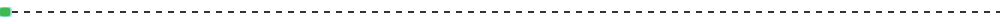
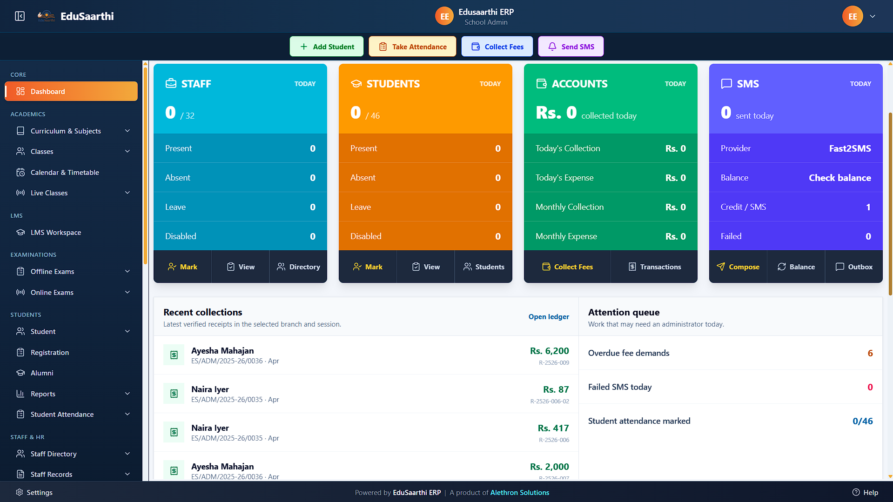
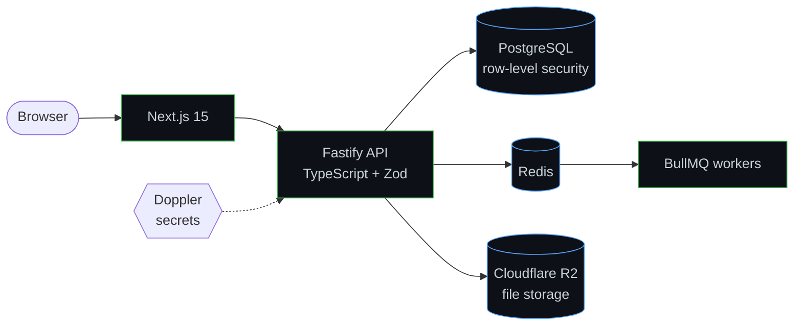
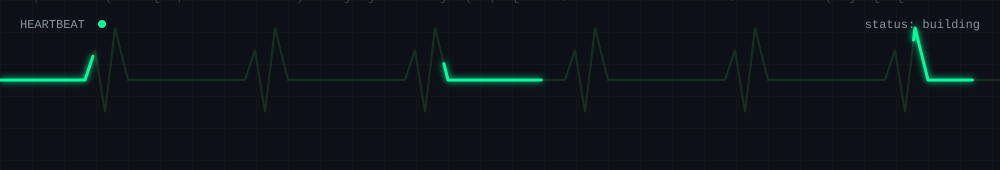

  

  

## 🟢 Live in Production

Not screenshots. A GitHub Action pings my live products every 30 minutes and renders this card.

## 🚀 Featured Projects

<table>
  <tr>
    <td width="50%" valign="top">
      <h3>🏫 EduSaarthi — School Management ERP</h3>
      
Enterprise-grade SaaS for schools, built and shipped solo under Alethron Solutions. Modular monolith with a deliberately lean six-role access model and Postgres row-level security.

      

        
        
        
        
        
        
      

      <a href="https://edusaarthi.app"><b>🔗 edusaarthi.app</b></a>
    </td>
    <td width="50%" valign="top">
      <h3>📈 Dhanwala — Investor Management Platform</h3>
      
Investor management platform built for Nivestra Capital, handling investor data and operations in one place.

      

        <!-- TODO: add the real stack badges -->
        
      

      <a href="https://dhanwala.in"><b>🔗 dhanwala.in</b></a>
    </td>
  </tr>
  <tr>
    <td width="50%" valign="top">
      <h3>🤖 Job Hunt Agent</h3>
      
Autonomous agent that scores resume-to-job fit, ranks postings and drafts tailored cover letters. Submitted to the <i>Agents for Humans</i> hackathon on Devpost.

      

        
        
        
      

      <!-- TODO: add repo / demo link -->
    </td>
    <td width="50%" valign="top">
      <h3>🛡️ Security & Fundamentals</h3>
      
Completed an 8-week <b>Ethical Hacking virtual internship</b> (EduSkills Academy, 2026). Currently grinding DSA and networking fundamentals.

      

        
        
      

    </td>
  </tr>
</table>

## 🧠 How EduSaarthi Is Built

**Design choices:** modular monolith over premature microservices, tenant isolation enforced in the database with row-level security, background jobs on a queue instead of the request path, and a six-role access model instead of a bloated 17-role design.

## 🛠️ Tech Stack

**Languages** 
  

**Frontend & Backend** 
  

**Databases** 
  

**Cloud & DevOps** 

## 📊 GitHub Analytics

 

## 🎯 Currently

- 🔭 Scaling **EduSaarthi** with real schools
- 🧩 Practising **DSA** daily
- 🔐 Going deeper into **cybersecurity** and **applied AI engineering**
- 🌱 Targeting a **software development internship** this year

**Open to:** internships · open-source contributions · beginner-friendly collaborations

